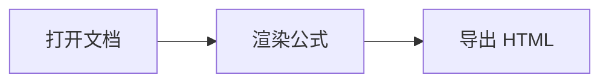

# Markdown 渲染验证

[跳到重复标题](#重复标题-1) · [脚注](#fn1)

行内公式：$E=mc^2$，括号公式：\(a^2+b^2=c^2\)。

$$
\int_0^1 x^2\,dx=\frac{1}{3}
$$

```typescript
const message: string = "代码高亮";
console.log(message);
```

```unknown-language
<unknown-code>must stay escaped</unknown-code>
```



说明文字[^note]。


| 格式 | 能力 |
| --- | --- |
| Markdown | 公式、脚注、图表 |

- [x] 任务列表
- [ ] 未完成项目

## 重复标题

第一节。

## 重复标题

第二节。

Setext 标题
-----------

```markdown
# 代码块内的伪标题
```

[^note]: 脚注内容与返回链接。
